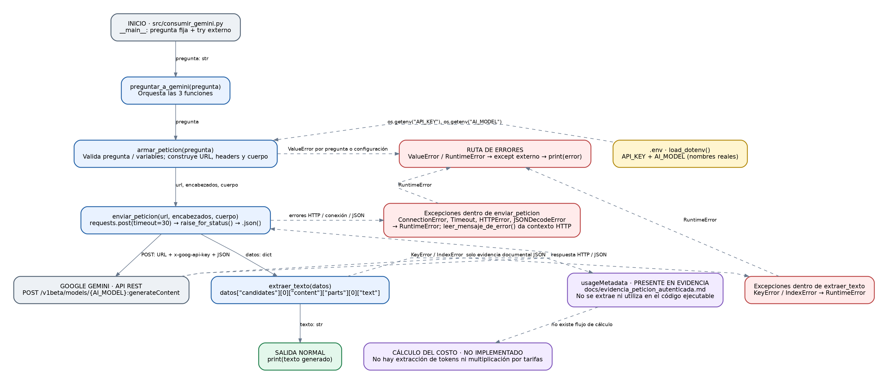

# ADR-001 — Decisión de arquitectura: elección del modelo Gemini

- **Fecha:** 20 de octubre de 2026
- **Estado:** Aceptada para el caso de uso evaluado (sujeta a revisión con pruebas más amplias)
- **Proyecto:** [plantilla-repositorio-base](https://github.com/diodZo/plantilla-repositorio-base)
- **Responsable:** Equipo del proyecto
- **Evidencia:** `comparacion_modelos.csv` (30 intentos, registrados el 20 de octubre de 2026, UTC)

## 1. Modelo elegido

**`gemini-3.5-flash-lite`** es el modelo seleccionado para la miniaplicación de preguntas y respuestas breves con la API de Gemini.

La elección se fundamenta en las mediciones del benchmark, no en una presunción de superioridad general. Para preguntas sencillas respondió correctamente, con menor latencia, menor costo estimado y sin fallos de HTTP observados en esta muestra.

**Configuración del proyecto:** `src/consumir_gemini.py` lee `AI_MODEL` y `API_KEY` desde el entorno, no tiene el modelo fijo en el código. Para adoptar la decisión en una instalación local, configurar `AI_MODEL=gemini-3.5-flash-lite` en `.env`, sin publicar la clave. El script de comparación se ejecutó sobre los modelos nombrados en el CSV; este ADR no afirma haber cambiado la configuración del repositorio.

## 2. Diagrama de arquitectura

[Ver el diagrama del Bloque 8](diagrama_arquitectura.png).

En `src/consumir_gemini.py`, el flujo verificado es:

1. El bloque `__main__` llama a `preguntar_a_gemini(pregunta)`.
2. `armar_peticion(pregunta)` valida la entrada, lee `API_KEY` y `AI_MODEL` mediante `os.getenv`, y entrega URL, encabezados y cuerpo JSON.
3. `enviar_peticion(url, encabezados, cuerpo)` realiza `requests.post` con `timeout=30`, comprueba el estado HTTP y convierte la respuesta a un diccionario.
4. `extraer_texto(datos)` recupera `candidates[0].content.parts[0].text`.
5. La respuesta se imprime. El bloque principal captura `ValueError` y `RuntimeError`.

Los errores de conexión y timeout, HTTP, JSON inválido y campos ausentes se manejan en las funciones correspondientes. **El módulo principal todavía no incorpora el cálculo del costo ni muestra `usageMetadata`**. Estas mediciones se realizan en el script independiente `utils/comparar_modelos_gemini.py`. Por tanto, el diagrama del Bloque 8 y este ADR documentan el flujo existente; no deben interpretarse como evidencia de una funcionalidad de costos integrada en la miniaplicación principal.

## 3. Comparación de candidatos

### Procedimiento y fuente de datos

Se utilizó `utils/comparar_modelos_gemini.py`: **5 rondas × 3 preguntas × 2 modelos = 30 intentos**. Se formularon las mismas tres preguntas a ambos modelos: una operación aritmética sencilla, la capital de Escocia y una explicación de API REST. La duración corresponde al tiempo observado de la solicitud HTTP desde el cliente. Las métricas de latencia, tokens y costo solo se computan sobre **solicitudes exitosas**; los fallos se contabilizan aparte para no sesgar el promedio con valores vacíos.

| Métrica | `gemini-3.5-flash-lite` | `gemini-3.8-flash` |
|---|---:|---:|
| Intentos | 15 | 15 |
| Respuestas exitosas | **15** | 12 |
| Tasa de éxito | **100 %** | 80 % |
| Fallos registrados (`HTTPError`) | **0** | 3 |
| Latencia media (exitosas) | **1,6101 s** | 10,5014 s |
| Latencia mediana (exitosas) | **0,9757 s** | 9,2140 s |
| Latencia mínima (exitosas) | 0,5865 s | 2,3342 s |
| Latencia máxima (exitosas) | 4,2870 s | 27,5407 s |
| Tokens de entrada promedio (exitosas) | 14,00 | 13,50 |
| Tokens visibles de salida promedio (exitosas) | 16,27 | 14,83 |
| Tokens de razonamiento promedio (exitosas) | **0,00** | 241,08 |
| Tokens totales promedio reportados por API (exitosas) | 30,27 | 269,42 |
| Costo estimado promedio por respuesta exitosa | **US$0,000044867** | US$0,000969813 |
| Costo estimado acumulado (solo exitosas) | **US$0,000673000** | US$0,011637750 |
| Calidad observada en preguntas sencillas | Adecuada | Adecuada |

**Datos:** [comparacion_modelos.csv](comparacion_modelos.csv). Conservar el CSV junto a este documento como evidencia de las mediciones.

**Costos y supuestos:** estos importes son los calculados en el CSV, a partir de las tarifas *configuradas en el benchmark* en USD por millón de tokens: Flash-Lite (entrada 0,30; salida 2,50) y Flash (entrada 0,75; salida 3,75). El cálculo suma `promptTokenCount × tarifa_entrada` y `(candidatesTokenCount + thoughtsTokenCount) × tarifa_salida`, dividiendo por 1.000.000. Son **estimaciones de comparación**, no cargos facturados ni verificación de tarifas oficiales vigentes. Verificar precios y modelo disponible antes de uso productivo.

**Precauciones metodológicas:** los 3 errores HTTP de Flash no contienen código de respuesta ni causa concreta; no se puede atribuir de forma concluyente al modelo. La muestra es pequeña y las preguntas son fáciles; no prueba desempeño en solicitudes extensas o razonamiento complejo. El campo de respuesta del benchmark se limita a 250 caracteres, por lo que su revisión no equivale a una evaluación exhaustiva de calidad.

## 4. Justificación de la elección

El objetivo de esta miniaplicación es resolver consultas breves de forma comprensible y rápida. Los criterios de mayor peso son **latencia percibida**, **costo estimado por consulta** y **fiabilidad de la solicitud**; una mayor capacidad de razonamiento no compensa por sí sola una respuesta más lenta para este caso.

En esta prueba Flash-Lite obtuvo una latencia media de 1,61 s frente a 10,50 s de Flash (aproximadamente **6,52 veces menor**). También tuvo un costo estimado medio por respuesta exitosa cercano a **21,6 veces menor**, y completó 15 de 15 peticiones frente a 12 de 15 del otro candidato. Las respuestas observadas a las preguntas sencillas fueron adecuadas en ambos casos. Por estos resultados, el modelo ligero proporciona el mejor equilibrio en el alcance medido.

## 5. Alternativa descartada y por qué

**Se descarta para este caso de uso `gemini-3.8-flash`**, no porque sea intrínsecamente peor, sino porque en las pruebas realizadas su latencia fue mayor, su costo estimado por respuesta también fue superior y registró tres fallos HTTP cuya causa aún debe investigarse. Su razonamiento adicional (241,08 tokens promedio en solicitudes exitosas) no mostró una ventaja clara en las tres tareas sencillas.

Se recomienda reconsiderarlo si el proyecto incorpora preguntas complejas, análisis de documentos, instrucciones extensas o pruebas de calidad que demuestren beneficios medibles.

## 6. Consecuencias y revisión futura

- Mantener la selección del modelo configurable mediante `AI_MODEL`.
- No incluir secretos en documentos, CSV ni repositorio. La clave real se debe guardar exclusivamente fuera de Git (por ejemplo, en `.env` excluido por `.gitignore`).
- Repetir el benchmark con más preguntas, múltiples horarios y registro del código HTTP en errores antes de tomar decisiones para producción.
- Validar las tarifas vigentes y conservar los resultados de las pruebas en `docs/`.
- Integrar el cálculo de tokens/costos en la miniaplicación principal solo si la siguiente unidad lo requiere; **esta decisión documental no cambia código**.
